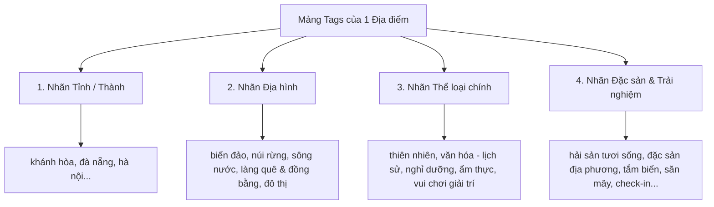

# 📘 TÀI LIỆU BÀN GIAO DỮ LIỆU & ĐẶC TẢ SCHEMA (DATA CONTRACT)
**Dự án:** Get-Set-N-Go (TravelMate App)  
**Người phụ trách:** Data Engineer / Dataset Specialist  
**Ngày hoàn thành:** 03/11/2026  
**Phiên bản dữ liệu:** v2.0 (Enriched & Normalized)  

---

## I. TỔNG QUAN TẬP DỮ LIỆU (DATASET OVERVIEW)

* **Số lượng bản ghi:** `315` điểm đến du lịch trên toàn lãnh thổ Việt Nam.
* **Nguồn dữ liệu gốc:** `DataSet.xlsx` (315 POIs ban đầu).
* **Nguồn làm giàu ngữ cảnh:** Kaggle `vuonglsts/vietnam-tourism-v2` (139 chủ đề, 1.386 đoạn văn ngữ cảnh hỏi đáp du lịch Việt Nam).
* **Tình trạng:** Đã làm sạch (Data Cleaning), chuẩn hóa trường nhãn (Tag Normalization) và nạp thành công vào Database.

---

## II. THÔNG TIN TRUY VẬN CƠ SỞ DỮ LIỆU (DATABASE SPEC)

Dành cho **Backend Developer**: Dữ liệu đã sẵn sàng trên MongoDB Atlas, Backend chỉ cần kết nối và truy vấn.

* **Database Name:** `get_set_n_go_db`
* **Collection Name:** `Places`
* **Số lượng Document:** `315`
* **File lưu trữ offline (Backup JSON):** `backend/data/places_enriched.json`

### Cấu trúc Schema (Document Structure):

```json
{
  "id": "P001",
  "name": "Bãi Dài Cam Ranh",
  "destination": "Khánh Hòa",
  "category": "sightseeing",
  "description": "Bãi biển hoang sơ với vẻ đẹp tự nhiên, lý tưởng để thư giãn và tắm biển...",
  "rating": "4.8/5",
  "image": "https://www.uncovervietnam.com/wp-content/uploads/2021/06/bai-dai-beach-cam-ranh-vietnam.jpg",
  "tags": [
    "khánh hòa",
    "biển đảo",
    "thiên nhiên",
    "nghỉ dưỡng",
    "hải sản tươi sống",
    "tắm biển & lặn ngắm san hô",
    "biển"
  ]
}
```

### Chi tiết các trường (Field Descriptions):

| Trường | Kiểu dữ liệu | Bắt buộc | Mô tả | Hướng dẫn cho Frontend / Backend |
| :--- | :--- | :---: | :--- | :--- |
| `id` | `String` | Có | Mã định danh duy nhất (`P001` - `P315`) | Dùng làm khóa `key` khi render danh sách. |
| `name` | `String` | Có | Tên chính thức của địa danh | Hiển thị tiêu đề thẻ điểm đến (Card Title). |
| `destination` | `String` | Có | Tỉnh / Thành phố trực thuộc | Dùng để lọc nhanh theo địa phương (`query by city`). |
| `category` | `String` | Có | Phân loại tổng quát (`sightseeing`, `culture`...) | Hỗ trợ phân loại cấp cao. |
| `description` | `String` | Có | Đoạn văn mô tả (đã làm giàu từ Kaggle) | Hiển thị chi tiết mô tả điểm đến. |
| `rating` | `String` | Có | Điểm đánh giá (ví dụ: `4.8/5`) | Hiển thị sao đánh giá. |
| `image` | `String` | Có | Đường dẫn ảnh chất lượng cao | Render ảnh bìa địa điểm. |
| `tags` | `Array[String]` | Có | Mảng các nhãn đặc trưng (đã chuẩn hóa) | **Input chính cho thuật toán Cosine Similarity & Filter UI.** |

---

## III. HỆ THỐNG PHÂN TẦNG NHÃN (TAG TAXONOMY)
> Dành cho **Frontend Developer** để thiết kế các nút bấm lọc (Filter Chips) và **Backend Developer** để đối sánh sở thích.

Mỗi địa điểm trong tập dữ liệu đều tuân theo mô hình **Hierarchical Tags (Nhãn phân tầng)**:



### 1. Nhóm Nhãn Địa hình (Terrain):
* `biển đảo`: Bãi tắm, vịnh, đảo, san hô.
* `núi rừng`: Đèo, thác nước, hang động, cao nguyên.
* `sông nước`: Sông, hồ, kênh rạch, chợ nổi miền Tây.
* `làng quê & đồng bằng`: Làng cổ, đình, chùa, cảnh quan đồng bằng Bắc Bộ.
* `đô thị`: Phố cổ, quảng trường, bảo tàng, trung tâm mua sắm.

### 2. Nhóm Nhãn Thể loại (Category):
* `thiên nhiên`, `văn hóa - lịch sử`, `nghỉ dưỡng`, `ẩm thực`, `vui chơi giải trí`.

### 3. Nhóm Nhãn Đặc sắc (Features):
* **Ẩm thực:** `hải sản tươi sống`, `đặc sản địa phương`, `cà phê & trà`, `ẩm thực đường phố`.
* **Trải nghiệm:** `kiến trúc & di tích cổ`, `lễ hội dân gian`, `tắm biển & lặn ngắm san hô`, `leo núi & trekking`, `ngắm hoàng hôn & bình minh`, `check-in sống ảo`, `du lịch tâm linh`.

---

## IV. HƯỚNG DẪN TRUY VẤN MẪU CHO BACKEND (CODE SNIPPET)

Backend Developer có thể truy vấn cực kỳ đơn giản qua `pymongo`:

```python
# Ví dụ: Lấy toàn bộ địa điểm tại Đà Nẵng để nạp vào thuật toán gợi ý
import pymongo

client = pymongo.MongoClient(MONGO_URI)
db = client["get_set_n_go_db"]

# Lọc không phân biệt hoa thường và ẩn trường _id
danang_places = list(db.Places.find(
    {"destination": {"$regex": "^Đà Nẵng$", "$options": "i"}},
    {"_id": 0}
))

print(f"Tìm thấy {len(danang_places)} địa điểm tại Đà Nẵng.")
```
